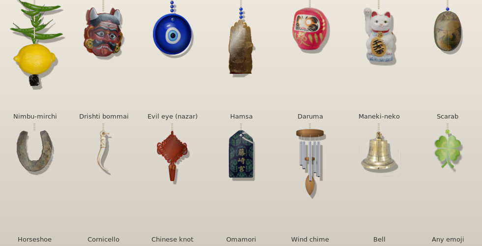

# Desk Charms

A lucky charm that hangs from the top of your Ubuntu screen on an elastic thread. It sways
on its own, slowly turns on the thread, and you can grab it, pull it anywhere on the screen
and let it go to watch it bounce back, with sound.



**Charms:** nimbu-mirchi, drishti bommai, evil eye (nazar), hamsa, daruma, maneki-neko,
scarab, horseshoe, cornicello, Chinese knot, omamori, wind chime, bell, and any emoji you like.

- Real photos turned into 3D objects: flat charms have thickness and a back, and figures turn like solids
- The nazar blinks, squints when you grab it, and its eye follows your mouse
- Elastic-thread physics: pull, fling and let go; it settles back into a gentle swing
- Sounds for each charm (twang, chime, bell, glass clink, wooden knock, iron clank)
- Clicks pass straight through everything except the charm itself
- Settings window: charm, size, swing, sound, volume, which screen, position, how many

Inspired by [Lucky Dangle](https://luckydangle.app) for macOS. This is a separate project for
Ubuntu and uses none of that app's code or artwork.

## Install

On Ubuntu 22.04 or newer (GNOME):

```sh
sudo apt install python3-gi python3-gi-cairo gir1.2-gtk-3.0 gir1.2-pango-1.0 \
                 pulseaudio-utils fonts-noto-color-emoji
git clone https://github.com/murtaza0053/desk-charms.git
cd desk-charms
./install.sh --autostart      # leave out --autostart if you don't want it at login
```

Then open **Desk Charms** from the app menu. To remove it: `./uninstall.sh`
(add `--purge` to delete your settings too).

To update, `git pull` and run `./install.sh` again.

## Using it

- **Drag** the charm to stretch the thread; let go to bounce. Fling it to set it spinning.
- **Click** it for a push.
- **Right-click** it for **Settings…** and **Quit**. You can also open **Desk Charms Settings**
  from the app menu; starting Desk Charms again while it runs opens its settings too.

Settings are saved in `~/.config/desk-charms/settings.json`. Command-line options override them
for one run, for example `python3 desk_charms.py --object nazar --size 2 0.1 0.9` (two nazars,
near the left and right edges). See `python3 desk_charms.py --help`.

### Wayland

Desk Charms is built and tested on an **X11 session** ("Ubuntu on Xorg"). The launchers start it
through XWayland, which should work on a Wayland session, but this is untested. If the charm
doesn't stay on top or clicks don't pass through, log out and pick *Ubuntu on Xorg* from the
gear icon on the login screen.

## How it works

| File | What it does |
|---|---|
| `desk_charms.py` | The app: transparent click-through window, elastic-thread physics, drawing, mouse, settings plumbing |
| `objects.py` | Every charm: its parts, sizes, how it turns in 3D, and its sounds. `KINDS` at the bottom lists them |
| `sprites.py` | Loading photos and drawing the parts made in code (wind chime, glass beads, the 3D nazar, eyelids) |
| `sounds.py` | All sounds are synthesised in code the first time and cached as WAV files |
| `settings.py` | Saved settings and the settings window |
| `assets/` | The cut-out photos, with their sources and licences in `assets/CREDITS.txt` |
| `tools/` | `cutout.py` cuts a charm out of a photo; `preview.py` renders charms without starting the app |

A charm is a list of *pieces* (images placed at a depth along the thread). The app turns the whole
charm by an angle: each piece moves sideways by `depth × sin(angle)` and squashes by
`cos(angle)`, and pieces are drawn back to front. Stacking thin slices of a charm's outline
gives it thickness, which is what makes the flat photos look 3D.

## Add your own charm

1. Find a photo of the charm on a plain background with a licence that allows sharing
   (Wikimedia Commons is a good place).
2. Cut it out (needs `sudo apt install python3-pil`):
   `python3 tools/cutout.py photo.jpg assets/mycharm.png --mode light`
   (`--mode dark` for a dark backdrop; see `--help`).
3. Add a line to `KINDS` in `objects.py`, next to the similar charms, for example:
   ```python
   PhotoCharm("mycharm", "My charm", "mycharm.png", 50, sound="clink",
              thick=3, material=(0.6, 0.5, 0.2), gloss=0.4),
   ```
   `width` is in the app's units (most charms are 40–66), `thick` is its thickness, `material`
   the colour of its edge and back, and `flat=False` makes it turn like a solid figure.
4. Check it: `python3 tools/preview.py mycharm`, then run `python3 desk_charms.py --object mycharm`.
5. Add the photo's source, author and licence to `assets/CREDITS.txt`.

## Contributing

Issues and pull requests are welcome: new charms, sounds, better Wayland support, other
desktops. For working on the code, `./install.sh --link` makes the installed app run straight
from your clone, so a restart picks up your changes. Please keep new photos to ones whose licence
allows sharing, and credit them.

## License

The code is under the [MIT License](LICENSE). The photos in `assets/` keep their own licences
(public domain, CC0, CC BY-SA and KOGL Type 1); see `assets/CREDITS.txt`. The CC BY-SA photos
must keep their credit, and changed versions of them must be shared under the same licence.
